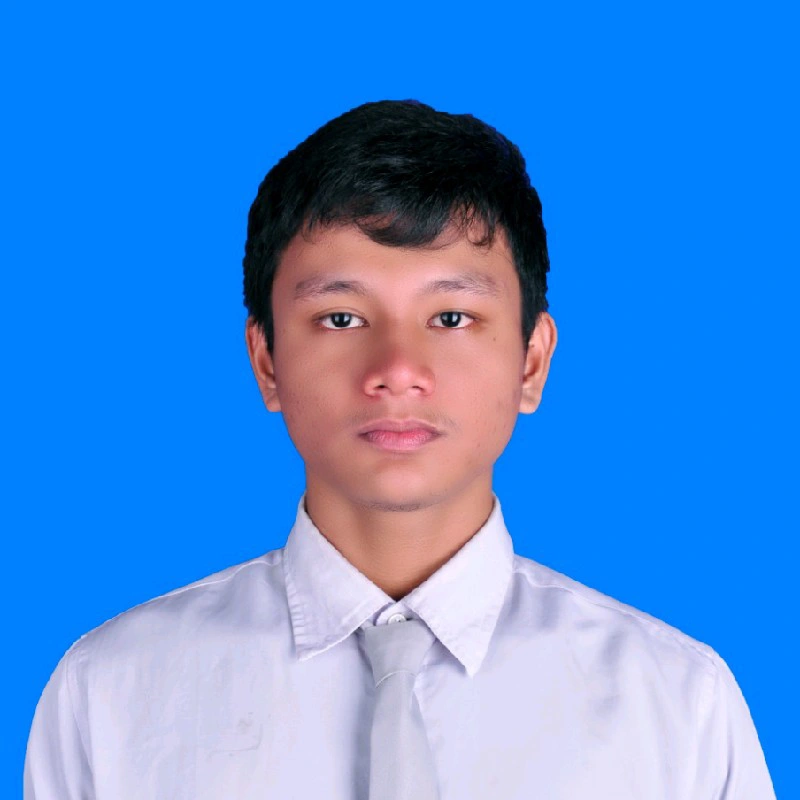

  
  <h1>Reihan Apriandi</h1>
  
<strong>Forestry &amp; Spatial Data Science</strong>

  
<em>Remote Sensing · Environmental Analytics</em>

---

## About Me

I am a forestry undergraduate at Universitas Riau, currently in my final year. My work so far
has moved between the field and the desk: supervising excavation sites for boundary compliance
in Riau, measuring forest plots for an above-ground biomass study on peatland, and digitizing
land cover data from satellite imagery at RECOFTC. On the analysis side I use QGIS, ArcGIS,
Google Earth Engine, and Python (Pandas, Matplotlib).

Alongside those, I built [Flood Coverage](projects/flood-coverage.md), an independent analysis
of whether a satellite actually observes a flood while it is rising, measured across four river
basins in Europe and Indonesia from one year of Sentinel-1 acquisition metadata.

I am looking for entry-level roles in GIS analysis, remote sensing, or environmental data work,
preferably connected to forest monitoring.

  

---

[View My Projects :material-arrow-right:](projects/index.md){ .md-button .md-button--primary }
[Download CV :material-download:](assets/reihan-CV.pdf){ .md-button }

---

## Skills

-   :material-satellite:{ .lg .middle } **Remote Sensing**

    - Land cover and land use change analysis from satellite imagery (NASA ARSET)
    - Active fire, smoke, and post-fire monitoring (NASA ARSET)
    - Water quality monitoring for lakes and coastal regions (NASA ARSET)
    - Hyperspectral imagery for land and coastal systems (NASA ARSET)
    - Marine and ocean data analysis (Copernicus Marine Service)
    - Accuracy assessment with confusion matrices (RECOFTC land cover validation)
    - Satellite acquisition coverage: revisit and gap analysis from STAC metadata (Flood Coverage)

-   :material-map:{ .lg .middle } **GIS & Mapping**

    - QGIS for cartography and spatial analysis (Advanced QGIS, Spatial Thoughts)
    - ArcGIS for climate-focused spatial analysis (Esri GIS for Climate Action)
    - Google Earth Engine for land cover monitoring
    - Web maps with Leaflet.js and Folium; dashboards with Streamlit
    - UAV photogrammetry with Agisoft Metashape and OpenDroneMap

-   :material-tree:{ .lg .middle } **Forestry & Field Work**

    - AGB and carbon stock surveys: DBH, height, and species identification (peatland study, PT Hatfield)
    - Allometric equations and ground-truth validation
    - Plot boundary staking and excavation compliance supervision
    - Forest policy and governance analysis (RECOFTC)
    - REDD+ and forest carbon frameworks (UNITAR / UN Environment)
    - Wildlife population density estimation (Harimau Kita tiger analysis)

-   :material-chart-line:{ .lg .middle } **Data Analysis & Machine Learning**

    - Data cleaning, analysis, and visualization (Google Data Analytics)
    - Python with Pandas and Matplotlib; R and SQL
    - Time series analysis (openHPI)
    - Supervised classification with scikit-learn (Oracle Cloud Data Science Professional, DataCamp AI Engineer Associate)
    - Statistical data analysis (DataCamp Certified Data Analyst Associate)
    - Reproducible pipelines with no external dependencies; API ingestion from STAC and Open-Meteo (Flood Coverage)

These skills come from named certifications, field projects, and published work. The complete list of certifications, with issuers and dates, is on the [Experience page](experience.md#certifications).

---

## Connect

[GitHub :fontawesome-brands-github:](https://github.com/Hansen-arch){ .md-button }
[LinkedIn :fontawesome-brands-linkedin:](https://www.linkedin.com/in/reihan-apriandi-700845266/){ .md-button }
[Email :material-email:](mailto:apriandireihan@gmail.com){ .md-button }
