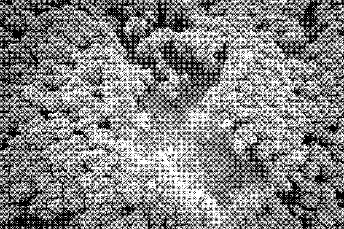
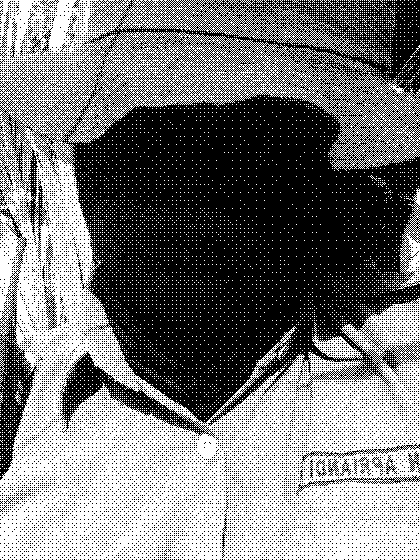

  Reihan Apriandi
  Field notes / 2026
  Pekanbaru 0.5071 N / 101.4478 E

&gt;_forestry / remote sensing / GIS

<h1 class="hero-name">Reihan Apriandi</h1>

Forestry undergraduate at Universitas Riau. I study forests and land cover in Indonesia with GIS and remote sensing.

<a class="md-button md-button--primary" href="assets/reihan-CV.pdf">Download CV</a>
<a class="md-button" href="projects/">See the projects</a>

<figure class="hero-plate">

<figcaption>Fig. 01 / forest canopy, Riau</figcaption>
</figure>

<dl class="readout">

<dt>based</dt><dd>Pekanbaru, Riau, Indonesia0.5071 N, 101.4478 E</dd>

<dt>study</dt><dd>BSc Forestry, Universitas Riau, final year</dd>

<dt>focus</dt><dd>GIS analysis, remote sensing, forest monitoring</dd>

<dt>status</dt><dd>Open to entry-level GIS and remote sensing roles</dd>

</dl>

## About

I have supervised excavation for boundary compliance in Riau, measured forest plots for an
above-ground biomass study on peatland, and digitized land cover from satellite imagery at
RECOFTC. I use QGIS, ArcGIS, Google Earth Engine, and Python with Pandas and Matplotlib.

I have also counted oil palms from UAV orthophotos
([Palm Tree Counting](projects/palm-tree-counting.md)), measured how often Sentinel-1 sees a
flood while it is rising ([Flood Coverage](projects/flood-coverage.md)), and built a quality
checker for GBIF species records ([BioSift](projects/biosift.md)). I mapped surface heat and
vegetation change in Pekanbaru ([Urban Heat Island](projects/urban-heat-island.md),
[Urban Green Space Change](projects/urban-green-space.md)).

I am looking for entry-level roles in GIS analysis, remote sensing, or environmental data
work, preferably connected to forest monitoring.

Portrait / undercover field operative, Riau, 2026

## Methods and tools

Methods from coursework, field projects, and the projects on this site. The full list, with
issuers and dates, is on the [Experience page](experience.md#certifications).

remote sensing

- Land cover and land use change from satellite imagery (NASA ARSET)
- Active fire, smoke, and post-fire monitoring (NASA ARSET)
- Water quality monitoring for lakes and coastal regions (NASA ARSET)
- Hyperspectral imagery for land and coastal systems (NASA ARSET)
- Marine and ocean data analysis (Copernicus Marine Service)
- Accuracy assessment with confusion matrices (RECOFTC land cover validation)
- Acquisition coverage: revisit and gap analysis from STAC metadata (Flood Coverage)

gis and mapping

- QGIS for cartography and spatial analysis (Advanced QGIS, Spatial Thoughts)
- ArcGIS for climate-focused spatial analysis (Esri GIS for Climate Action)
- Google Earth Engine for land cover monitoring
- Web maps with Leaflet.js and Folium; dashboards with Streamlit
- UAV photogrammetry with Agisoft Metashape and OpenDroneMap

forestry and field

- AGB and carbon stock surveys: DBH, height, species identification (peatland study, PT Hatfield)
- Allometric equations and ground-truth validation
- Plot boundary staking and excavation compliance supervision
- Forest policy and governance analysis (RECOFTC)
- REDD+ and forest carbon frameworks (UNITAR / UN Environment)
- Wildlife population density estimation (Harimau Kita tiger analysis)

data and code

- Data cleaning, analysis, and visualization (Google Data Analytics)
- Python with Pandas and Matplotlib; R and SQL
- Time series analysis (openHPI)
- Supervised classification with scikit-learn (Oracle Cloud Data Science Professional, DataCamp AI Engineer Associate)
- Statistical data analysis (DataCamp Certified Data Analyst Associate)
- Pipelines with no external dependencies; API ingestion from STAC and Open-Meteo (Flood Coverage)

## Links

[GitHub](https://github.com/Hansen-arch){ .md-button }
[LinkedIn](https://www.linkedin.com/in/reihan-apriandi-700845266/){ .md-button }
[Email](mailto:apriandireihan@gmail.com){ .md-button }

