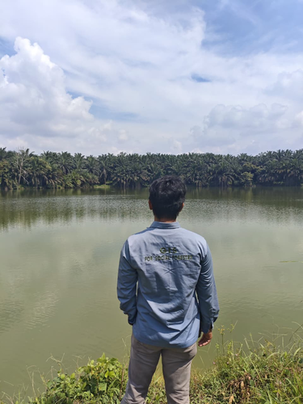

# Reihan Apriandi

Forestry undergraduate at Universitas Riau, working between the field and the desk: satellite land cover, forest carbon plots, and the gaps in satellite observation measured from real acquisition metadata.

<dl class="readout">
  <dt>based</dt>
  <dd>Pekanbaru, Riau, Indonesia0.5071 N, 101.4478 E</dd>
  <dt>study</dt>
  <dd>BSc Forestry, Universitas Riau, final year</dd>
  <dt>focus</dt>
  <dd>GIS analysis, remote sensing, forest monitoring</dd>
  <dt>status</dt>
  <dd>Open to entry-level GIS and remote sensing roles</dd>
</dl>

[Download CV](assets/reihan-CV.pdf){ .md-button .md-button--primary }
[See the projects](projects/index.md){ .md-button }

## About me

I am a forestry undergraduate at Universitas Riau, in my final year. My work has moved
between the field and the desk: supervising excavation for boundary compliance in Riau,
measuring forest plots for an above-ground biomass study on peatland, and digitizing land
cover from satellite imagery at RECOFTC. On the analysis side I use QGIS, ArcGIS, Google
Earth Engine, and Python with Pandas and Matplotlib.

Most of what is published here started as a question a map could not answer. I counted
24,966 oil palms from UAV orthophotos to see whether a detector can replace a hand count
([Palm Tree Counting](projects/palm-tree-counting.md)). I built
[Flood Coverage](projects/flood-coverage.md) to measure how rarely a satellite looks at a
flood while it is rising, from a year of acquisition metadata. I built
[BioSift](projects/biosift.md) because a species record is only as useful as its
coordinates. Closer to home, I mapped where Pekanbaru stores heat
([Urban Heat Island](projects/urban-heat-island.md)) and where it lost vegetation
([Urban Green Space Change](projects/urban-green-space.md)), because those two claims
are usually made in the same breath without being measured separately.

I am looking for entry-level roles in GIS analysis, remote sensing, or environmental data
work, preferably connected to forest monitoring.

## Capabilities

Every line below comes from a named certification, a field project, or published work. The
full list, with issuers and dates, is on the [Experience page](experience.md#certifications).

remote sensing

- Land cover and land use change from satellite imagery (NASA ARSET)
- Active fire, smoke, and post-fire monitoring (NASA ARSET)
- Water quality monitoring for lakes and coastal regions (NASA ARSET)
- Hyperspectral imagery for land and coastal systems (NASA ARSET)
- Marine and ocean data analysis (Copernicus Marine Service)
- Accuracy assessment with confusion matrices (RECOFTC land cover validation)
- Acquisition coverage: revisit and gap analysis from STAC metadata (Flood Coverage)

gis and mapping

- QGIS for cartography and spatial analysis (Advanced QGIS, Spatial Thoughts)
- ArcGIS for climate-focused spatial analysis (Esri GIS for Climate Action)
- Google Earth Engine for land cover monitoring
- Web maps with Leaflet.js and Folium; dashboards with Streamlit
- UAV photogrammetry with Agisoft Metashape and OpenDroneMap

forestry and field

- AGB and carbon stock surveys: DBH, height, species identification (peatland study, PT Hatfield)
- Allometric equations and ground-truth validation
- Plot boundary staking and excavation compliance supervision
- Forest policy and governance analysis (RECOFTC)
- REDD+ and forest carbon frameworks (UNITAR / UN Environment)
- Wildlife population density estimation (Harimau Kita tiger analysis)

data and code

- Data cleaning, analysis, and visualization (Google Data Analytics)
- Python with Pandas and Matplotlib; R and SQL
- Time series analysis (openHPI)
- Supervised classification with scikit-learn (Oracle Cloud Data Science Professional, DataCamp AI Engineer Associate)
- Statistical data analysis (DataCamp Certified Data Analyst Associate)
- Pipelines with no external dependencies; API ingestion from STAC and Open-Meteo (Flood Coverage)

## Connect

[GitHub](https://github.com/Hansen-arch){ .md-button }
[LinkedIn](https://www.linkedin.com/in/reihan-apriandi-700845266/){ .md-button }
[Email](mailto:apriandireihan@gmail.com){ .md-button }

