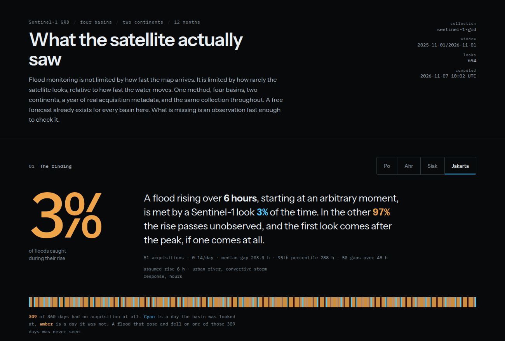
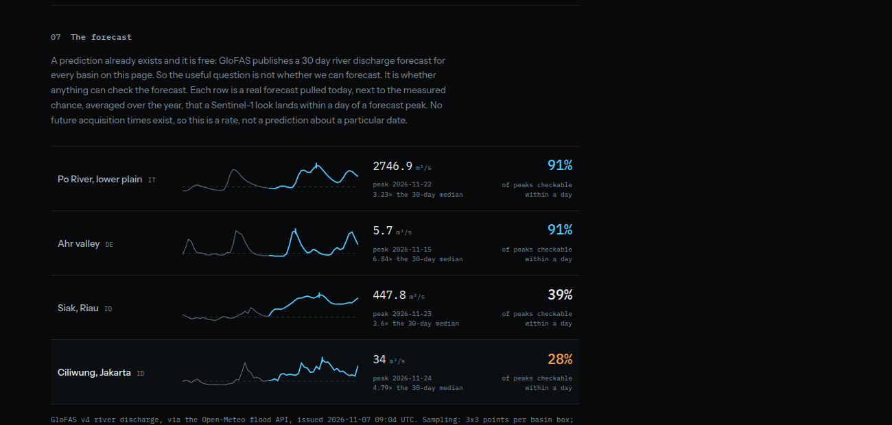

# Flood Coverage



## Overview

Flood Coverage asks a question that flood maps do not answer: if a flood rises over the
next six hours, will a satellite see it while it is rising?

Public flood mapping has largely solved speed. Copernicus GFM publishes a global 20 m flood
layer in under eight hours for more than 99% of scenes, and the fastest documented activation
delivered its first extent eight hours after trigger. The limit that remains is not processing
time but how rarely the satellite looks, compared with how fast the water moves. A basin can
be described as monitored on every dashboard while a short flood passes entirely between two
passes.

The project measures that gap from real acquisition metadata rather than assuming it, and then
pairs the result with the free GloFAS discharge forecast that already exists for each basin, to
ask whether the forecast peak can be verified at all.

| | |
|---|---|
| **Study areas** | Po river plain (IT), Ahr valley (DE), Siak (Riau, ID), Ciliwung (Jakarta, ID) |
| **Period** | 1 November 2025 to 1 November 2026 |
| **Role** | Solo project |
| **Status** | Working analysis and demo, source public |

---

## The measurement

The probability is computed empirically, not modelled. Take the real acquisition timestamps
for a year, slide a rise window across them in one hour steps, and count how often a look falls
inside the window.

```
P(rise observed) = windows containing at least one look / all windows
```

Passes cluster, so the answer differs sharply from the nominal revisit figure. The same run also
reports the gap distribution, so any rise time can be read off without re-running.

### Results, one year and one collection

| Basin | Looks per year | Looks per day | Median gap | 6 h rise seen | 48 h rise seen |
|---|---|---|---|---|---|
| Po, Italy | 315 | 0.87 | 24.0 h | 21% | 91% |
| Ahr, Germany | 250 | 0.69 | 24.0 h | 17% | 91% |
| Siak, Riau | 78 | 0.22 | 120.1 h | 5% | 39% |
| Ciliwung, Jakarta | 51 | 0.14 | 203.3 h | 3% | 28% |

The Po and the Ahr have almost the same cadence, 0.87 and 0.69 looks per day and a 24 hour median
gap, and they land in completely different places: 90% against 17% at a six hour rise. Nothing
about the satellites changed between them. The rise time did. Jakarta's median gap of 203 hours
means a flash flood is essentially never observed while it is rising, and its longest blackout
in the year ran 288 hours, from 22 September to 4 October 2026.

### Can the forecast be checked?

GloFAS already issues a free 30 day river discharge forecast for every basin here, so prediction
is not the hard part. Each forecast peak is paired with the measured chance that a look lands
within 24 hours of it.



| Basin | Forecast peak | Date (2026) | Versus 30 day median | Checkable within a day |
|---|---|---|---|---|
| Po | 2746.9 m³/s | 22 Nov | 3.2x | 91% |
| Ahr | 5.7 m³/s | 15 Nov | 6.8x | 91% |
| Siak, Riau | 447.8 m³/s | 23 Nov | 3.6x | 39% |
| Ciliwung, Jakarta | 34.0 m³/s | 24 Nov | 4.8x | 28% |

Europe can check its own forecast. Jakarta cannot: for 72% of forecast peaks no look lands within
a day, so the forecast is issued, acted on, and never verified.

---

## Methods & Tools

**Data sources**

- Sentinel-1 GRD acquisition metadata, queried through the Microsoft Planetary Computer STAC API
- GloFAS v4 river discharge forecast, through the Open-Meteo forecast API
- Esri World Dark Gray basemap, for the locator map only

**Processing steps**

1. Search the STAC API for each basin's bounding box over the 12 month window
2. Deduplicate polarisation pairs so each overpass counts once
3. Compute the gap distribution, the median and 95th percentile gap, and the count of gaps over 48 hours
4. Slide the rise window across the record in one hour steps to estimate the observation probability at 3, 6, 12, 24, 48, 72 and 168 hours
5. Pull the GloFAS forecast per basin on a 3x3 sampling grid, keeping the cell with the highest median discharge, because the basin centroid often falls on a headwater cell
6. Pair each forecast peak with the measured probability that a look falls within 24 hours of it

**Tools**

| Tool | Purpose |
|------|---------|
| Python standard library | Ingest, statistics, and the web server |
| STAC API (HTTP + JSON) | Sentinel-1 acquisition metadata |
| Open-Meteo API | GloFAS discharge forecast |
| HTML, CSS, vanilla JavaScript | The page, with no build step |
| MapLibre GL JS | Locator map of the basin boxes |

The analysis runs on the Python standard library alone: no dependencies, no API keys, no build
step. Every statistic on the page is computed locally from the downloaded metadata.

---

## What the app does

- Shows, per basin, the share of randomly timed floods of a chosen rise length that contain at least one acquisition
- Draws the whole sweep from 3 to 168 hours, so the conclusion can be read at any rise time instead of resting on one assumption
- Renders the full year as a strip, one tick per acquisition, with every gap drawn at its true length
- Reports the longest blackout in the year and how many separate floods would fit inside it
- Pairs today's GloFAS forecast peak with the measured chance that it can be confirmed by a look

---

## What it does not tell you

- No acquisition is not no flood. A gap means no look, not absent water, and nothing is rendered as zero.
- Rise times are assumptions, not per-event measurements, which is why the page shows the full sweep.
- GloFAS covers rivers only, on a grid that does not resolve small steep catchments, and it is not a flood warning.
- Four basins do not describe the world. Both European basins sit inside the acquisition scenario that plans them for frequent revisit, and the Indonesian pair shows how far below that coverage can fall.
- This is a personal analysis, not a peer reviewed study.

---

## Links

[Source code](https://github.com/Hansen-arch/flood-coverage){ .md-button .md-button--primary }
[Method note](https://github.com/Hansen-arch/flood-coverage/blob/main/docs/03-method.md){ .md-button }
