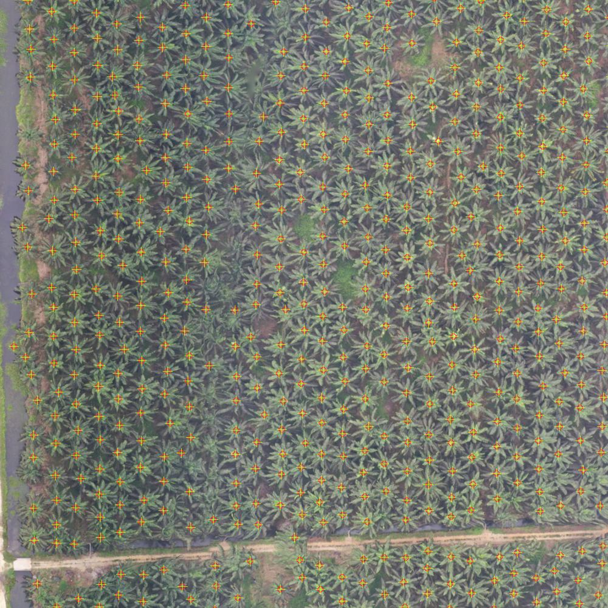
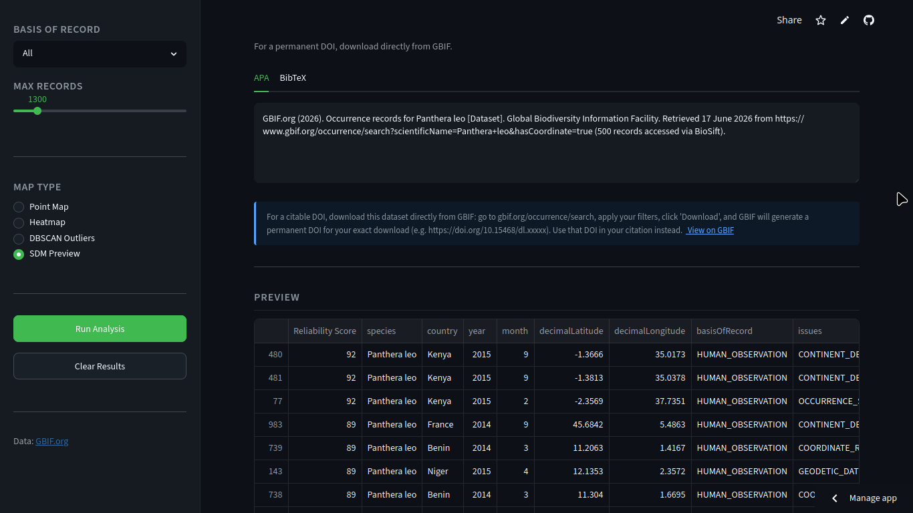
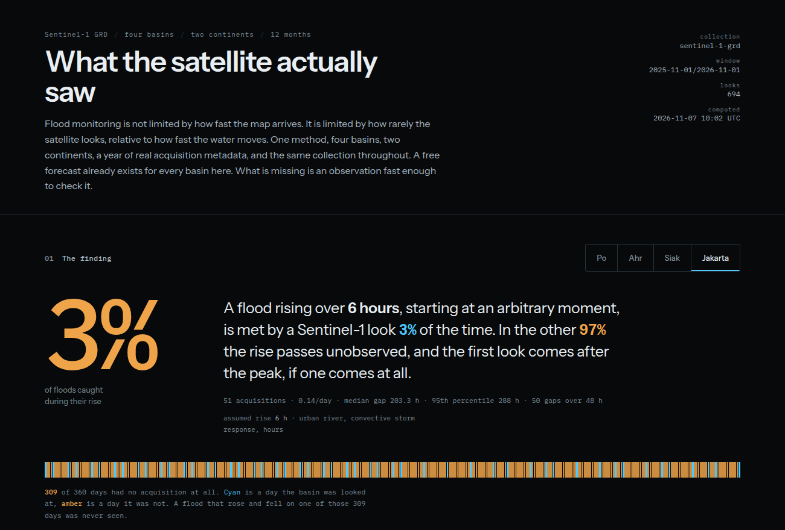
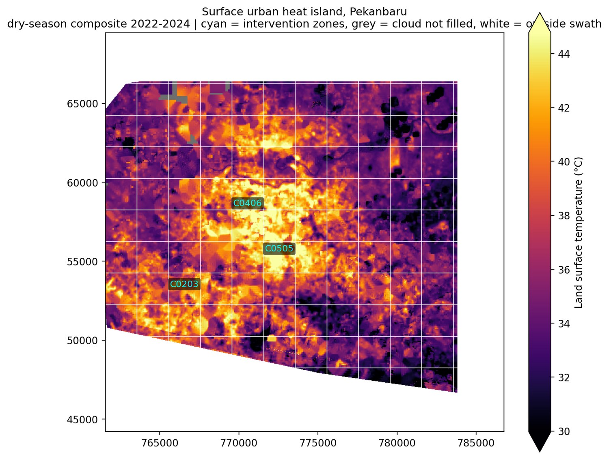
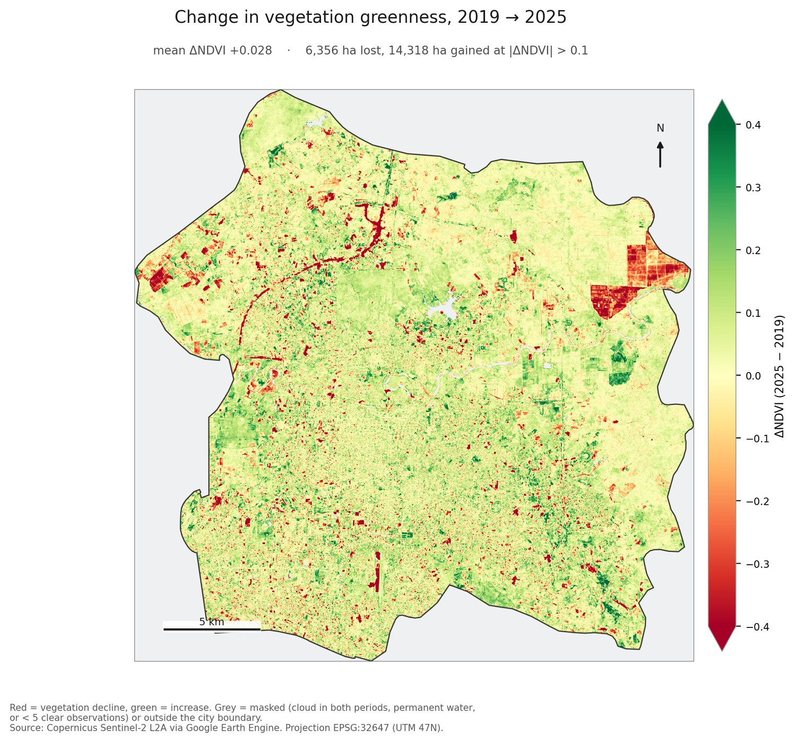

# Projects

Five projects, each built to answer a question that existing maps or dashboards did not.
The numbers on their pages come from the projects themselves.

01

## [Palm Tree Counting](palm-tree-counting.md)

Oil palm tree counting from UAV orthophotos. A YOLOv8 detector runs on a free Colab GPU,
detections return as georeferenced points with crown sizes, and 24,966 trees over 310
hectares are counted against a 500 m river setback.

`Python` `YOLOv8` `GDAL` `Colab` `QGIS`

02

## [BioSift](biosift.md)

Web app that checks the quality of GBIF species occurrence records. Ten automated quality
checks, spatial outlier detection, and Darwin Core Archive export. Built for the 2026 GBIF
Ebbe Nielsen Challenge.

`Python` `Streamlit` `GBIF` `scikit-learn` `folium`

03

## [Flood Coverage](flood-coverage.md)

Measures how often a Sentinel-1 pass lands inside a flood's rise, across four river basins
in Europe and Indonesia, and whether a GloFAS forecast peak can actually be checked. One
year of real acquisition metadata, computed locally.

`Python` `STAC` `Sentinel-1` `GloFAS` `JavaScript`

04

## [Urban Heat Island](urban-heat-island.md)

Surface heat across Pekanbaru from Landsat thermal data. A medoid composite closed with
per-pixel regression raises clear coverage to 79.9%, ships its own uncertainty layer, and
ranks three intervention zones on heat and vegetation loss.

`Python` `Landsat` `Google Earth Engine` `rasterio` `NumPy`

05

## [Urban Green Space Change](urban-green-space.md)

Where Kota Pekanbaru lost and gained vegetation between 2019 and 2025, from Sentinel-2 at
20 m. 62,110 ha analysed, every pixel attributed to a land-cover class, and the result
tested against a second sensor.

`Python` `Sentinel-2` `Google Earth Engine` `WorldCover` `Matplotlib`

