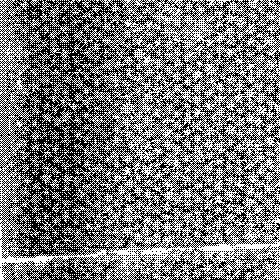
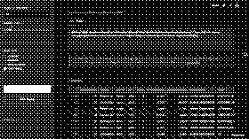
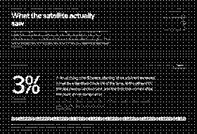
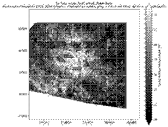
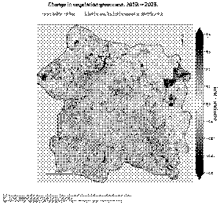

# Projects

Five projects in forestry, remote sensing, and environmental data.

01

## [Palm Tree Counting](palm-tree-counting.md)

Oil palm counting from UAV orthophotos with a YOLOv8 detector. The detections are
georeferenced points with crown sizes; 24,966 trees over 310.8 hectares were checked
against a 500 m river setback.

`Python` `YOLOv8` `GDAL` `Colab` `QGIS`

02

## [BioSift](biosift.md)

A web app for checking GBIF species occurrence records before analysis. It runs ten quality
checks, flags spatial outliers, and exports a Darwin Core Archive. Submitted to the 2026
GBIF Ebbe Nielsen Challenge.

`Python` `Streamlit` `GBIF` `scikit-learn` `folium`

03

## [Flood Coverage](flood-coverage.md)

A measurement of how often Sentinel-1 sees a flood while it is rising, across four river
basins in Europe and Indonesia. It uses one year of acquisition metadata and asks whether a
GloFAS forecast peak can be checked with a satellite pass.

`Python` `STAC` `Sentinel-1` `GloFAS` `JavaScript`

04

## [Urban Heat Island](urban-heat-island.md)

Surface temperature across Pekanbaru from Landsat thermal data. A medoid composite and a
regression fill bring clear coverage to 79.9%, with an uncertainty layer. Three intervention
zones are ranked by heat and vegetation loss.

`Python` `Landsat` `Google Earth Engine` `rasterio` `NumPy`

05

## [Urban Green Space Change](urban-green-space.md)

Vegetation loss and gain in Kota Pekanbaru between 2019 and 2025, from Sentinel-2 at 20 m.
The analysis covers 62,110 ha, attributes every pixel to a land-cover class, and checks the
result against Landsat.

`Python` `Sentinel-2` `Google Earth Engine` `WorldCover` `Matplotlib`

