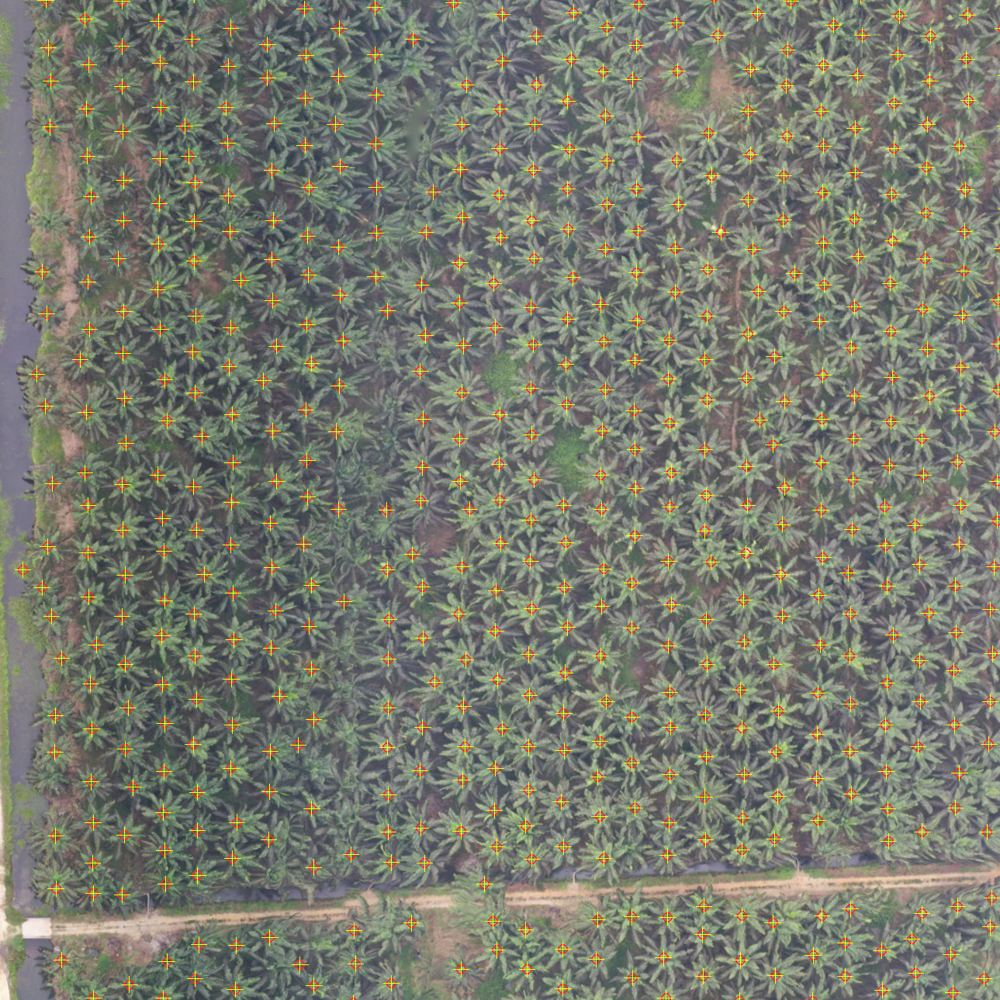
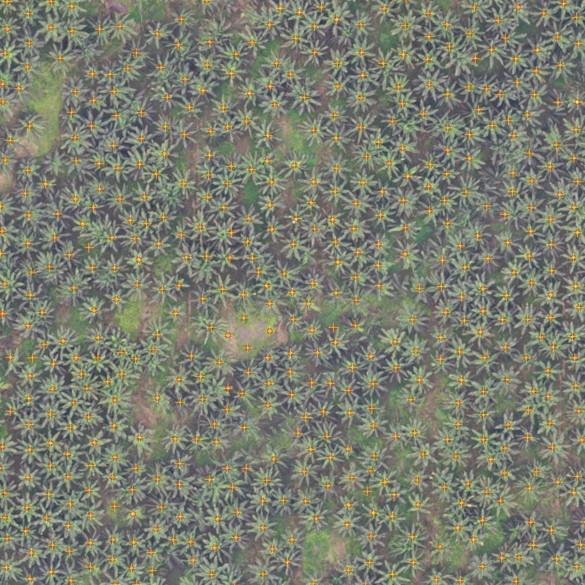

# Palm Tree Counting

{ .plate }

Plate 01 · merged mosaic, block 47N · 0.155 m ground pixel

## Overview

Counting oil palms by hand from aerial imagery is slow. A single block of a few hundred
hectares holds tens of thousands of crowns, and the count has to be redone whenever a block
is replanted, thinned, or audited.

This project counts them automatically. Five UAV orthophotos covering just over 310 hectares are
merged into one mosaic, the mosaic is resampled to the ground resolution the detector was trained
at, a YOLOv8 model runs inference on a free GPU in Google Colab, and the detections come back as
georeferenced points that carry a confidence value and a crown size in metres. The points then go
into ordinary GIS analysis. Here that means counting how many trees fall inside a 500 m river
setback and inside the 5 m river polygons themselves.

The run produced 24,966 trees over 310.8 hectares, a density of 80.3 trees per hectare.

| | |
|---|---|
| **Study area** | Oil palm blocks in Riau, Indonesia (UTM zones 47N and 48N) |
| **Imagery** | UAV orthophotos, 0.071 m to 0.155 m ground pixel |
| **Year** | 2026 |
| **Role** | Solo project |
| **Status** | Pipeline complete, source public |

---

## How the count is made

### Merge before detecting

When orthophotos overlap, detecting each file separately counts every tree in the overlap twice,
and the total inflates by however much the files share. The inputs are therefore merged into a
single raster first, so each point on the ground is visited once. The output grid is snapped to
the pixel grid of the sharpest source rather than to the union of all extents, which keeps that
source free of resampling blur, and the mosaic is written lossless with overviews so a multi
gigapixel file still pans smoothly in QGIS.

### Match the ground resolution

A detector only recognises objects at the scale it learned. The model was trained on 640 pixel
tiles at 0.155 m ground pixel, which is 99 m of ground per tile. On the 0.071 m orthophoto the
same tile covers only 46 m, so every tree appears twice as large and accuracy falls even though
the image is sharper. The imagery is resampled to 0.155138 m before inference, which also cuts the
work: the tile count on that block dropped from roughly 3,300 to 735.

### Overlapping tiles, one global deduplication

The mosaic is cut into strips locally, then processed as overlapping square tiles on the GPU.
Overlap is kept large because a crown on a tile edge would otherwise be seen only partially.
Transparent gaps between flight corridors are skipped using the alpha band, raw boxes are filtered
by confidence, and non maximum suppression removes duplicate boxes. That is not enough in a
regularly planted orchard, where two strong boxes can land on one crown, so a final spatial filter
removes any detection closer than a minimum distance to a stronger one. The distance comes from
the expected planting spacing, and it is applied across the whole dataset rather than per tile,
which is what closes the leakage at strip boundaries.

### One row per tree

Each surviving box becomes its centre point, with the box dimensions converted from pixels to
metres using the raster resolution. The points are written as GeoPackage, GeoJSON and CSV in the
CRS of the input imagery, so crown size statistics arrive for free and every detection can be
reviewed in QGIS before it is used.

---

## Results

| Source | Valid area | Trees | Density | Median confidence |
|---|---|---|---|---|
| Mosaic of four orthos (47N) | 310.8 ha | 24,966 | 80.3 /ha | 0.697 |
| ORTO 47N, run as its own file | 138.1 ha | 12,864 | 93.1 /ha |  |
| PMBN1 47N | 63.5 ha | 6,008 | 94.6 /ha | 0.755 |
| PMBN3 47N | 48.2 ha | 399 | 8.3 /ha | 0.633 |
| PMBN ORTO2 (tagged 48S, actually 48N) | 90.2 ha | 8,040 | 89.1 /ha | 0.704 |

The low density on PMBN3 comes from the block itself, not a detection failure: it holds far
fewer palms over a similar area than its neighbours.

### Detector accuracy

The model is a YOLOv8 nano fine tuned on a public Roboflow Universe dataset of 2,730 images and
180,170 boxes, and evaluated on a 280 image validation split from that same dataset.

| Metric | Value |
|---|---|
| mAP@50 | 0.977 |
| Precision / recall | 0.955 / 0.955 |
| mAP@50-95 | 0.745 |
| F1 at IoU 0.5 on a production check | 0.814 (recall 84.6%, precision 78.5%) |
| Count bias in production use | plus or minus 8% |
| Agreement with an independent digitising pass | 92% |

The first three rows describe the public dataset, not these blocks. The count bias and the 92%
agreement are the numbers that apply to the plantation imagery.

### The same trees, counted two ways

Detecting each orthophoto separately and detecting the merged mosaic once should give the same
answer. Checking that shows whether the mosaic step changes the count:

| Source | Per ortho | On mosaic | Difference |
|---|---|---|---|
| ORTO 47N | 93.1 /ha | 93.0 /ha | -0.1% |
| PMBN1 47N | 94.6 /ha | 98.8 /ha | +4.4% |
| PMBN ORTO2 (48N) | 89.1 /ha | 86.9 /ha | -2.5% |

### River setback analysis

Three of the orthophotos were tested against a 500 m setback shapefile and 5 m wide river
polygons, as a demonstration that the point layer is analysis ready and not just a picture.

| Item | Value |
|---|---|
| Trees inside the 500 m setback | 2,253 of 6,495 |
| Trees inside the 5 m river polygons | 100, across 6 river segments |
| Setback clip area per ortho | 20.8 / 5.3 / 20.0 ha |
| River clip area per ortho | 1.05 / 0.27 / 1.02 ha |

No reprojection is needed for this step, because the points and the zones share a CRS. The same
scripts clip the source rasters to each zone so the counts can be checked.

---

## Methods & Tools

**Data sources**

- UAV orthophotos in RGB with an alpha band, five files across UTM zones 47N and 48N
- A public oil palm detection dataset on Roboflow Universe for fine tuning, 2,730 images and 180,170 boxes
- 500 m river setback and 5 m river polygon shapefiles, supplied as vector zones

**Processing steps**

1. Merge the orthophotos into one lossless mosaic on a grid snapped to the sharpest source
2. Resample to the 0.155138 m ground sample distance used in training
3. Cut the mosaic into strips, then run overlapping tile inference on a Colab T4 GPU with the alpha band masking empty ground
4. Deduplicate detections globally by confidence and minimum planting distance, then convert boxes to centre points with crown dimensions in metres
5. Export to GeoPackage, GeoJSON and CSV, and render every detection back onto the imagery for a visual check
6. Count points inside the setback and river polygons, and clip the rasters to those zones

**Tools**

| Tool | Purpose |
|------|---------|
| Python | The whole pipeline, run as scripts |
| GDAL / OGR (osgeo) | Mosaicking, resampling, raster and vector I/O |
| Ultralytics YOLOv8 + PyTorch | Detector training and inference |
| Google Colab, T4 GPU | Free GPU for training and tile inference |
| NumPy, SciPy | Raster arrays, morphology, spatial filtering |
| QGIS | Visual review of detections and zone counts |

**A CRS error in one file.** The second block's orthophoto is tagged WGS 84 / UTM zone 48S
with a false northing of 10,000,000, but its coordinates resolve to 0°21' N, north of the equator
in zone 48N. As tagged, the file sits in the wrong hemisphere, so its CRS was corrected before it
was used with the others. The pipeline checks CRS and ground resolution before inference because
an error like that is invisible until a layer lands in the wrong place.

---

## Limitations

- There are no ground plots. The plus or minus 8% is count bias on a labelled validation split plus run to run consistency, not a field measurement. Narrowing it needs stems counted on the ground.
- The 0.977 mAP belongs to the public training dataset. It says the model learned that data well, not that it scores the same on these blocks.
- In the densest rows, touching crowns with no contrast between them merge into one detection, so recall is the weak side there. A stricter separation threshold splits more of them and lowers the count.
- A tree count is not tree health, age, or yield. Crown area is measured, nothing about the palm itself is.
- The plantation imagery is not public, so the repository ships the pipeline and a sample of the output rather than the results themselves.
- Positions are only as good as the orthophoto's georeferencing. The pipeline inherits it and cannot improve on it.

---

## Links

[Source code](https://github.com/Hansen-arch/palm-tree-counting-yolo){ .md-button .md-button--primary }
[Technical report](https://github.com/Hansen-arch/palm-tree-counting-yolo/blob/main/docs/REPORT.md){ .md-button }
