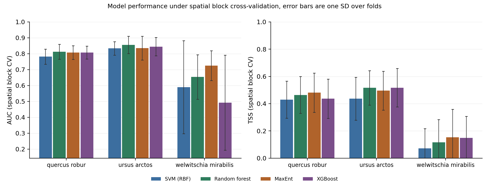
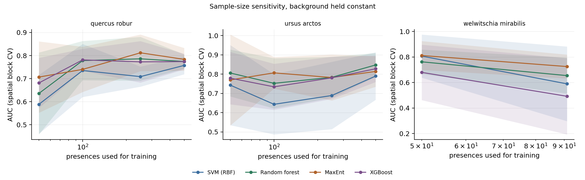

# Species Distribution Models

{ .plate }

Plate 01 · three species, spatial block CV · AUC and TSS, bars are one SD over folds

## Overview

Four algorithms are used here to predict where a species can occur from climate: maximum
entropy (MaxEnt), random forest, an RBF support vector machine and XGBoost. Reports often
compare them across different datasets, which mixes the algorithm with the data. This
project holds the data fixed and changes only the model.

Presences come from GBIF, thinned to one record per 10 arc minute cell. Climate comes from
WorldClim 2.1 at the same resolution, pruned to the variables that are not collinear at
|r| > 0.8. All four models get the same 2,000 background cells, the same predictors and the
same folds, so a difference in the table is a difference between models.

Each model is scored twice: once with stratified random 5-fold and once with spatial block
5-fold on a 5 by 5 grid. The second scheme is the reference, because random folds let
neighbouring records fall into different folds and measure interpolation between them.

| | |
|---|---|
| **Study area** | Europe (Quercus robur, Ursus arctos) and the Namib (Welwitschia mirabilis) |
| **Projection** | WGS 84, WorldClim 2.1 at 10 arc minutes (about 18 km) |
| **Source** | GBIF occurrence records; WorldClim 2.1 bioclim and elevation |
| **Records** | 9,000 pulled per species where available, then thinned to one per grid cell |
| **Role** | Solo project |
| **Status** | Complete, source public |

---

## The comparison

Spatial block cross-validation, five folds. AUC is rank based. TSS uses a threshold fitted
on a held-out 30 percent calibration split inside each training fold, so it is never tuned
on the data the model was fitted to.

| Species | Presences | SVM (RBF) | Random forest | MaxEnt | XGBoost |
|---|---|---|---|---|---|
| Quercus robur | 1,835 | 0.782 / 0.430 | **0.813** / 0.464 | 0.808 / **0.480** | 0.807 / 0.437 |
| Ursus arctos | 1,418 | 0.833 / 0.436 | **0.856** / 0.516 | 0.835 / 0.495 | 0.844 / **0.517** |
| Welwitschia mirabilis | 91 | 0.590 / 0.072 | 0.654 / 0.116 | **0.725** / **0.152** | 0.492 / 0.149 |

Cells read as AUC / TSS, bold marks the best value in the row.

On the oak, with 1,835 presences and ten predictors, the four models sit within 0.031 AUC
and 0.05 TSS of each other. MaxEnt has the highest TSS, random forest the highest AUC. At
that sample size the gap is fold noise, and the four predictions support the same
description of the species' climatic niche.

The 91-record case is different. The spread there is 0.233 AUC. MaxEnt holds 0.725 and
XGBoost falls to 0.492, which is chance: 400 boosting rounds exceed what that dataset can
support, and one of the five blocks held too few presences to score, so the species is
averaged over four folds with a standard deviation of 0.299. The SVM fails in a different
way. It predicted the whole extent suitable (area fraction 1.000), so its TSS of 0.072
comes from calling everything present.

## What random folds would have said

| Model | Mean AUC, random folds | Mean AUC, spatial blocks | Inflation |
|---|---|---|---|
| MaxEnt | 0.890 | 0.789 | +0.101 |
| Random forest | 0.885 | 0.774 | +0.111 |
| SVM (RBF) | 0.865 | 0.735 | +0.131 |
| XGBoost | 0.883 | 0.715 | +0.168 |

Every model loses between 0.10 and 0.17 AUC when neighbouring records are kept in the same
fold, and the flexible learners lose the most. A comparison built on random folds puts
XGBoost above MaxEnt; under spatial blocks the order reverses. That reversal is the result
I would flag to anyone reading an SDM paper that reports random-fold AUC only.

The learning curves locate where each model starts to work. MaxEnt is at 0.707 AUC with 50
oak presences and 0.784 with all of them, while random forest climbs from 0.636 to 0.774
over the same range.

## Which algorithm fits which data situation

| Situation | Start with | Why, from this panel |
|---|---|---|
| Under about 100 usable presences | MaxEnt | 0.725 against 0.492 to 0.654 here, and it is the only model whose predictions are not degenerate at that size |
| 100 to 500 presences | MaxEnt, then random forest | the curves cross near 100; both are defensible, and random forest has lower variance across folds once it has data |
| Several thousand presences | Random forest or MaxEnt | 0.813 against 0.808 on the oak; pick on what the output is for, not on AUC |
| Clustered, fragmented records | Random forest | 0.856 on the bear, the highest in the panel |
| A probability for policy or reporting | MaxEnt | cloglog output on a 0 to 1 scale; tree vote fractions are not probabilities |
| Prediction into a novel climate | MaxEnt | clamping limits extrapolation, and trees cannot extrapolate at all |

---

## Methods & Tools

**Processing steps**

1. Query GBIF for accepted records with coordinates, no fatal geospatial issue, present
   status, since 1950, and fetch pages in parallel up to 9,000 records per species
2. Apply seven quality gates in order (coordinate validity, study extent, GBIF issue flags,
   basis of record, year, stated uncertainty, duplicate coordinates) and record how many
   records each gate removes
3. Thin to one record per 10 arc minute cell, keeping the best located record
4. Clip WorldClim 2.1 bioclim and elevation to the extent and drop variables correlated
   above |r| = 0.8, leaving ten predictors shared by every model
5. Draw 2,000 background cells once per species and pass them to all four models, including
   MaxEnt, which normally samples its own
6. Fit the four models with fixed hyperparameters and score each under random and spatial
   block folds, with TSS taken from a calibration split inside each training fold

**Tools**

| Tool | Purpose |
|------|---------|
| Python: scikit-learn | random forest, RBF SVM, XGBoost wrapper, GroupKFold |
| maxent.jar 3.4.4 | reference MaxEnt build, driven from a subprocess |
| pygbif, requests | occurrence retrieval from the GBIF API |
| rasterio, rioxarray | WorldClim clipping, ASCII grids for MaxEnt, prediction stacks |
| pandas, Matplotlib | tables, figures, provenance record |

---

## Limitations

- 10 arc minute resolution sets a floor on what can be modelled. A first candidate, Nepenthes rajah, had 80 records at a stated 31 km precision, which left two grid cells after thinning, so it was replaced by Welwitschia mirabilis.
- 9,000 records is a cap, not the population. The oak has 1.7 million records available, and the search API stalls beyond about 10,000 offsets, so the cap is recorded in the provenance file.
- One background size, no bias correction. Sampling effort is uneven in reality, and no target-group background is used.
- Hyperparameters are fixed a priori so tuning cannot leak into the comparison, which means the table measures each algorithm's default behaviour rather than its best.
- AUC compares models within a species, never across species, because the extent and the background differ between cases.
- MaxEnt needs a display even in batch mode, so the remote Colab runner selects the three scikit-learn models instead.

---

## Links

[Source code](https://github.com/Hansen-arch/species-distribution-models){ .md-button .md-button--primary }
[Results tables](https://github.com/Hansen-arch/species-distribution-models/tree/main/results){ .md-button }
