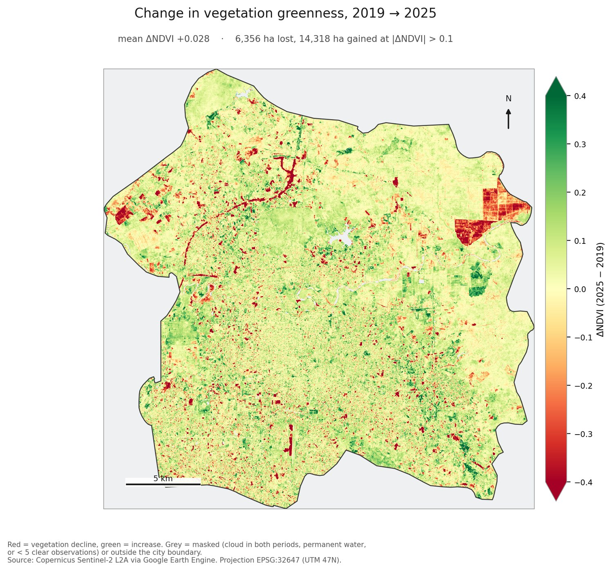
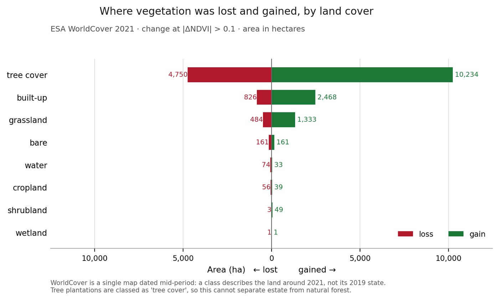
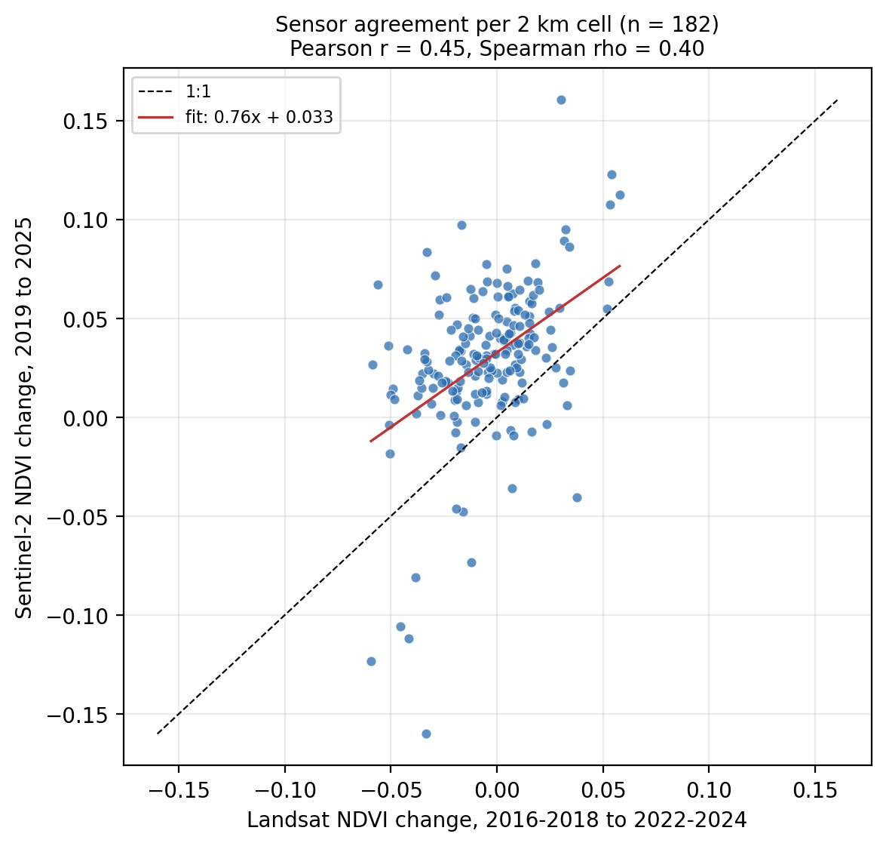

# Urban Green Space Change

{ .plate }

Plate 01 · Kota Pekanbaru boundary, UTM 47N · 20 m NDVI change, 2019 to 2025

## Overview

Pekanbaru grew quickly into surrounding forest, plantation and peat. The question here is
narrower than "is the city getting greener": which ground lost vegetation, which gained it,
and what was on that ground when the change happened.

Two calendar years of Sentinel-2 surface reflectance are compared on the city boundary
itself, at the resolution of the cloud mask rather than a convenient round number. Cloud is
handled per pixel from the Sentinel-2 classification layer, and pixels without at least five
clear observations in both years are dropped rather than averaged over whatever survived.

| | |
|---|---|
| **Study area** | Kota Pekanbaru, Riau (FAO GAUL 2025 boundary), 62,884 ha |
| **Projection** | WGS 84 / UTM zone 47N (EPSG:32647), 20 m |
| **Source** | Sentinel-2 L2A surface reflectance, SCL cloud mask |
| **Periods** | 2019 (43 scenes) and 2025 (39 scenes) |
| **Role** | Solo project |
| **Status** | Analysis complete, source public |

---

## Method

### Why 20 m, and why whole years

The Sentinel-2 classification layer that carries the cloud flag is native at 20 m. Analysing
at 10 m would mean interpolating the mask, so 20 m is the finest grid where the mask is an
observation rather than a guess.

Each period is a median of every clear observation in the calendar year. The composite is
built per pixel, so a scene that is cloudy over the city but clear over the rest of the tile
is not thrown away, and about 15 clear observations per pixel survive on average.

A pixel is analysed only if it has at least five clear observations in both periods and is
not permanent water, so the city mean is a land figure and not a river statistic. That
leaves 62,110 ha, or 98.8% of the city.

### Change classes and attribution

Change is classified at plus or minus 0.03 NDVI, roughly the noise floor between two clear
composites, and the areas come from summing pixel area rather than multiplying a pixel count
by a nominal size. Every analysed pixel is then labelled with ESA WorldCover 2021 and the
classes are cross-tabulated, so the attribution totals reconcile with the headline.

---

## Results

Mean NDVI rose from **0.576 to 0.605** (+0.028). The headline is a net figure, and the net
hides the structure.

| | 2019 | 2025 | Change |
|---|---|---|---|
| Mean NDVI | 0.576 | 0.605 | **+0.028** |
| Median NDVI | 0.668 | 0.707 | +0.039 |
| Scenes used | 43 | 39 | n/a |

| Class (change above 0.10 NDVI) | Area (ha) | Share |
|---|---|---|
| Loss | 6,356 | 10.2% |
| Stable | 41,436 | 66.7% |
| Gain | 14,318 | 23.1% |
| **Net** | **+7,962** | |

### Where the change happened

Tree cover carries most of both sides: 4,750 ha lost and 10,234 ha gained, a net +5,485 ha.
Built-up land shows 2,468 ha of gain against 826 ha of loss, which is more plausibly canopy
and garden vegetation inside settlements than new buildings, since the built-up class
includes vegetated urban surfaces.

The clearest single loss is a 270 ha rectilinear block in the east of the city at
101.557 E, 0.592 N, where composite NDVI fell from 0.701 to 0.509. It held 17.2 and 15.1
clear observations per pixel in the two periods, so it is a real change rather than a cloud
gap, and edges that straight are the signature of plantation block clearing rather than
gradual urban creep.

### 2019 was a low starting point

Running the composite for every year shows the two comparison years in context: NDVI climbs
from 0.572 to a 2022 peak of 0.624 and then flattens to about 0.600. Part of the 2019 to
2025 increase is recovery from a dry, fire-affected 2019 in Riau, not a sustained greening
trend. The 2022 to 2025 decline of about 0.025 is the more useful signal for present
conditions.

### Two independent checks

Both checks exist because a single-sensor result deserves suspicion.

| Check | Result |
|---|---|
| Dry-season window instead of whole years (Landsat) | net -0.004, area losing 29.0% |
| Whole-year window (Landsat) | net -0.008, area losing 29.5% |
| Sentinel-2 against Landsat per 2 km cell | r = 0.45 over 182 cells (p = 2e-10) |

The loss share barely moves between windows, so the loss finding is robust while the net
mean is not: a mean of a bimodal change distribution is the balance of two large opposing
areas, not a typical pixel. The cross-sensor comparison puts the two instruments on the same
2 km cells and finds they agree on *where* change happened, while Sentinel-2 reads about
0.03 NDVI higher, which matches the low 2019 baseline rather than contradicting it.

---

## Methods & Tools

**Processing steps**

1. Filter Sentinel-2 L2A to one calendar year per period with a loose scene cloud filter,
   because cloud is handled per pixel afterwards
2. Keep only SCL classes 4, 5, 6 and 11; drop shadow, cloud, cirrus, saturated and no-data
3. Build per-pixel median NDVI for each period, with a clear-observation count per period
4. Apply the analysis mask: at least five clear observations in both periods, and not
   permanent water
5. Difference the composites, classify at plus or minus 0.03 and plus or minus 0.10, and sum
   pixel area for exact hectares
6. Label every pixel with ESA WorldCover 2021 and cross-tabulate the classes against change
7. Test the result against a seasonal window and against a second sensor

**Tools**

| Tool | Purpose |
|------|---------|
| Google Earth Engine | composites, cloud masking, zonal statistics, pixel area |
| Python: earthengine-api, rasterio | download, raster handling |
| NumPy, Matplotlib | classification, tables, figures |
| ESA WorldCover 2021 | land-cover attribution |

---

## What it does not tell you

- NDVI is greenness, not green space. A young oil palm block and a remnant forest can share a value and differ completely in cooling, carbon and biodiversity. A land-cover claim needs a classification, not an index.
- NDVI saturates in dense canopy, so loss inside the most heavily forested cells is likely understated. Three of the five largest losses started above 0.75.
- The attribution is dated mid-period. WorldCover 2021 describes the land around 2021, not its 2019 state, and plantations are labelled as tree cover, so the estate-versus-forest question stays open.
- Two epochs are not a trend. A steady decline and a decline followed by recovery look identical here.
- 2019 was a low, fire-affected year, which inflates any comparison that starts there.
- The boundary is administrative, not a functional urban area.

---

## Links

[Source code](https://github.com/Hansen-arch/urban-green-space-change){ .md-button .md-button--primary }
[Technical write-up](https://github.com/Hansen-arch/urban-green-space-change#readme){ .md-button }
