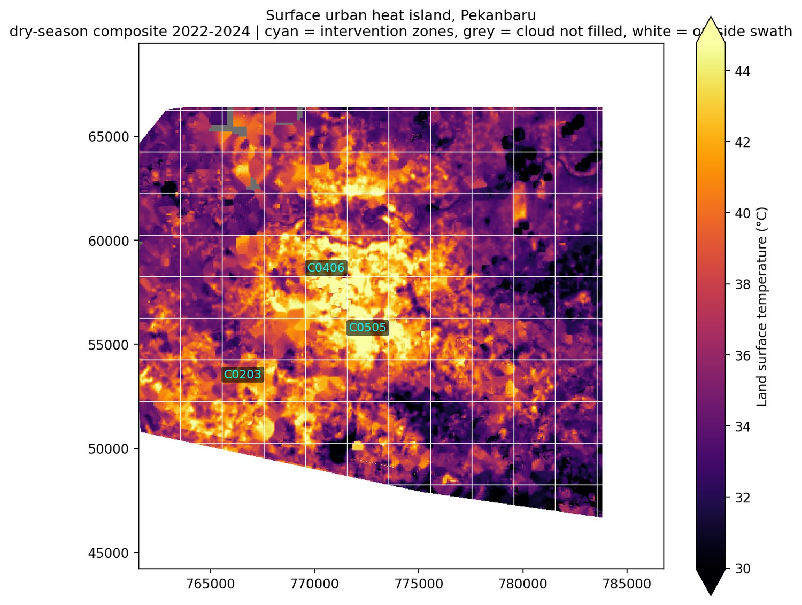
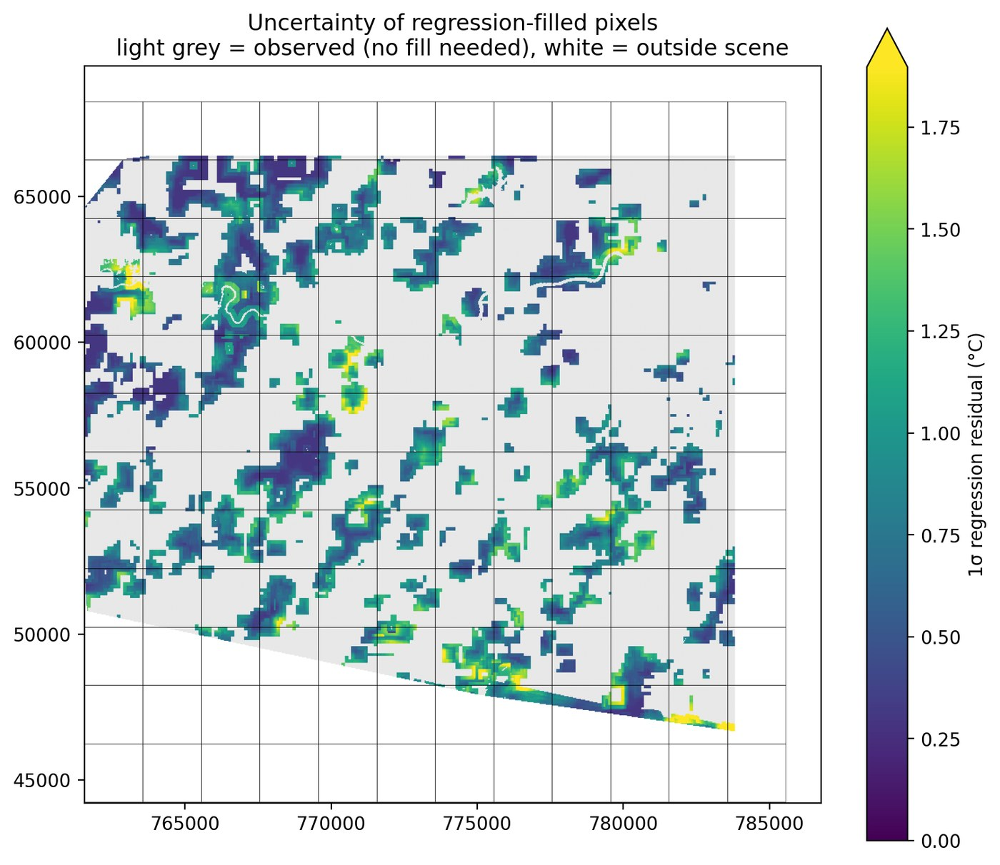
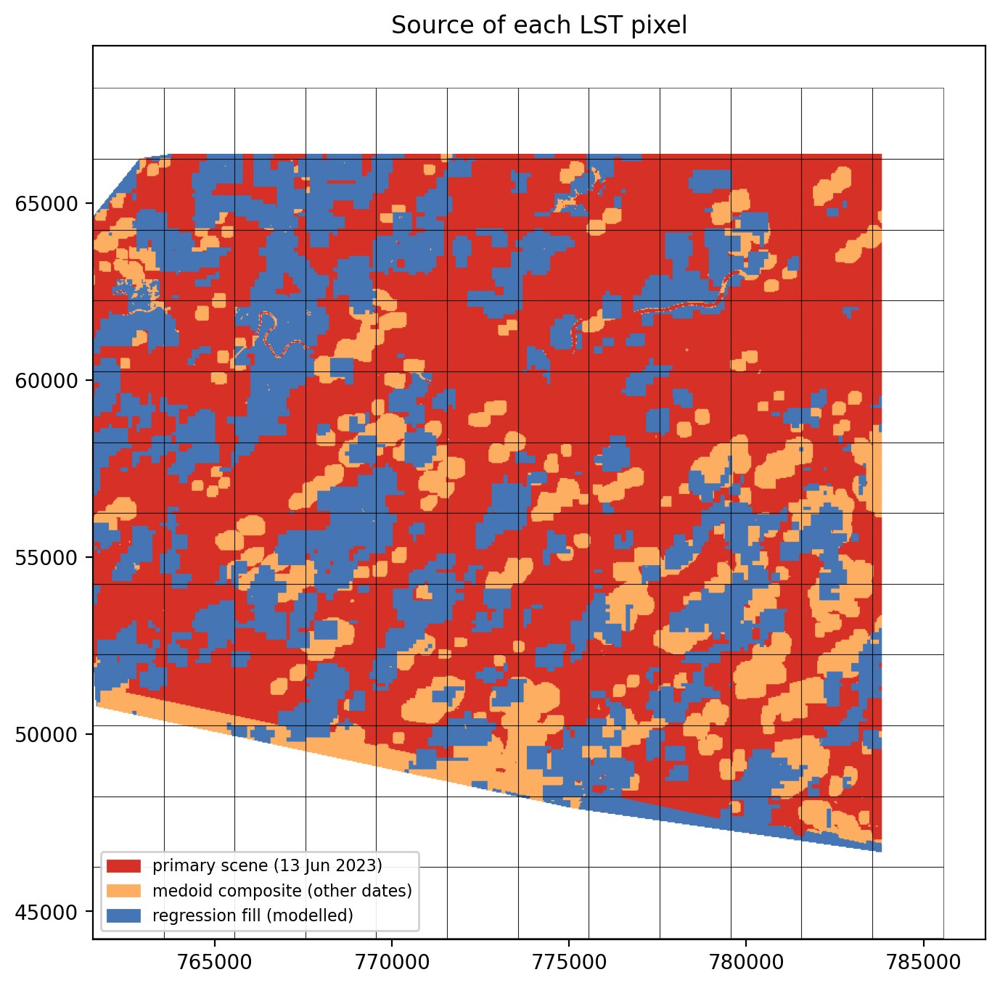

# Urban Heat Island

{ .plate }

<p class="plate-caption">Plate 01 · Pekanbaru, UTM 47N · 30 m thermal, dry-season composite 2022-2024</p>

## Overview

Residents of Pekanbaru report hotter afternoons, but a heat complaint is not a map. This
project asks three questions a map can answer: which parts of the city have the highest
land surface temperature, whether those areas are also the areas that lost vegetation, and
where a first round of cooling interventions would do the most good.

The hard part is not the thermal band. It is cloud. In the reference scene from 13 June
2023 only 43.8% of the study area was clear, and the cloud sat over exactly the built-up
ground the question is about. Dropping those pixels would have produced a map of the
suburbs and called it a city.

So the analysis builds the composite in two stages with different claims attached to each,
and publishes the difference.

| | |
|---|---|
| **Study area** | Pekanbaru, Riau, Indonesia (101.35 to 101.55 E, 0.40 to 0.60 N) |
| **Projection** | WGS 84 / UTM zone 47N (EPSG:32647), 30 m |
| **Source** | Landsat 8/9 Collection 2 Level-2, band ST_B10 |
| **Period** | 2022 to 2024 dry seasons |
| **Role** | Solo project |
| **Status** | Pipeline complete, source public |

---

## How the temperature map is built

### Two stages, two meanings

A medoid composite takes, for every pixel, the clear observation nearest the per-pixel
median across 15 selected scenes. Unlike a median it is always one real reading from one
real date, so no value is an average of dates. It raised clear coverage from 43.8% to 56.8%
of the raster.

Large cloud blobs still had no clear observation in any of the 53 candidate scenes. For
those, a linear model predicts temperature from the mean of surrounding clear pixels in a
9 by 9 window, with the pixel itself excluded from the fit so the model never trains on the
value it predicts. Four passes run in sequence, each filling a ring further into the cloud,
because a newly filled pixel becomes a neighbour for the next pass. Filling stops at the
convex hull of everything any scene observed, so nothing is invented beyond the satellite
swath.

| Stage | Share of raster | What the value means |
|---|---|---|
| Reference scene only | 43.8% | same-day observation |
| plus medoid composite | 13.0% | real observation, different date |
| plus regression fill | 23.1% | modelled, not observed |
| **Total coverage** | **79.9%** | |

### The uncertainty layer

A filled pixel without an error estimate is a guess wearing a colour ramp. Every modelled
pixel therefore carries a 1 sigma error from regression residuals pooled in a moving 25 by
25 window, so heterogeneous urban surfaces get wider bars than uniform ones. The median
uncertainty across filled pixels is 0.75 K, the 95th percentile 1.43 K.



The provenance map is the honest version of the heat map. Red is the reference scene,
orange is a real observation from another date, blue is modelled. A conclusion about a blue
area is weaker than one about a red area, and the map says which is which.



### Ranking the zones

Each 2 km cell gets mean, minimum and maximum temperature, the share of its area that is
observed rather than modelled, and a priority score:

```
priority = 0.6 * z(mean LST) + 0.4 * z(-ndVI change)
```

Hot cells score high. Cells that lost vegetation score high. Missing vegetation change
counts as zero loss rather than dropping the cell, so a cell without a vegetation record can
still rank on heat alone.

---

## Results

Across the 125 cells with data, mean land surface temperature is 35.9 °C, ranging from
27.9 °C to 43.7 °C. That is a spread of nearly 16 K inside one city, and it is not diffuse:
the heat forms a contiguous core north of the Siak and a second belt along the eastern
built-up corridor, with cooler ground over vegetated and peaty fringes.

| Rank | Cell | Mean LST (°C) | Change in NDVI | Priority | Modelled area |
|---|---|---|---|---|---|
| 1 | C0505 | 43.4 | -0.006 | 1.40 | 28.7% |
| 2 | C0406 | 43.7 | +0.001 | 1.19 | 29.2% |
| 3 | C0203 | 40.8 | -0.014 | 1.16 | 13.2% |

C0406 is the hottest cell in the city. C0505 pairs slightly lower heat with measurable
vegetation loss. C0203 is the coolest of the three but lost the most vegetation, which is
why it outranks hotter but greener cells.

### The vegetation result that did not behave

Vegetation declined in 113 of 125 cells, mean change -0.009 in NDVI. The correlation between
mean temperature and vegetation change is **+0.31**: hotter cells tended to lose *less*
vegetation, not more.

That sign is the opposite of the naive expectation, and it is worth stating rather than
smoothing. The likely explanation is that the hottest cells were already built up with
little vegetation left to lose, while the largest NDVI losses happened on vegetated fringes
that stay comparatively cool. NDVI change measures where vegetation disappeared, not where
heat is worst. The two signals are complementary, which is why they are combined into one
score instead of one being used to confirm the other.

---

## Methods & Tools

**Processing steps**

1. Filter path 127 row 59 to 53 scenes for 2022 to 2024, score each by clear share over the
   area of interest, keep the best 15
2. Mask dilated cloud, cirrus, cloud and shadow from QA_PIXEL bits 1 to 4, and treat
   ST_B10 = 0 as missing rather than as cold ground
3. Convert to Celsius with the Collection 2 scaling, then build the medoid composite and
   keep the reference scene where it is clear
4. Fill the remaining gaps by regression on the local neighbourhood mean, four passes,
   stopping at the swath boundary
5. Compute per-pixel uncertainty and a provenance class, then zonal statistics on a 2 km
   grid with coverage shares
6. Rank cells by heat and vegetation loss, and draw the plate

**Tools**

| Tool | Purpose |
|------|---------|
| Google Earth Engine | scene selection, cloud masking, download |
| Python: rasterio, NumPy, SciPy | compositing, regression fill, zonal statistics |
| GeoPandas, Shapely | grid cells, swath hull, overlays |
| Matplotlib | plates |

---

## What it does not tell you

- The 2 km grid is not a neighbourhood. No official boundary layer was available, so cells stand in for administrative units, and real boundaries would move the zone edges.
- This is not a single-day snapshot. The composite mixes dates, so it represents typical dry-season conditions, not the afternoon of 13 June 2023.
- About 23% of the mapped area is modelled. Median error is 0.75 K, but a stationary regression cannot see land change between dates, so the largest filled blobs are likely worse than that number suggests.
- Land surface temperature is not air temperature and not the heat a pedestrian feels. Dense shade can be cool at the surface while trapping heat at street level.
- Path 127 leaves the south-west and south-east corners uncovered. Adding path 126 or 128 would close them.
- Emissivity comes from the Landsat product and is least reliable over peatland and water.

---

## Links

[Source code](https://github.com/Hansen-arch/pekanbaru-uhi){ .md-button .md-button--primary }
[Technical write-up](https://github.com/Hansen-arch/pekanbaru-uhi#readme){ .md-button }
